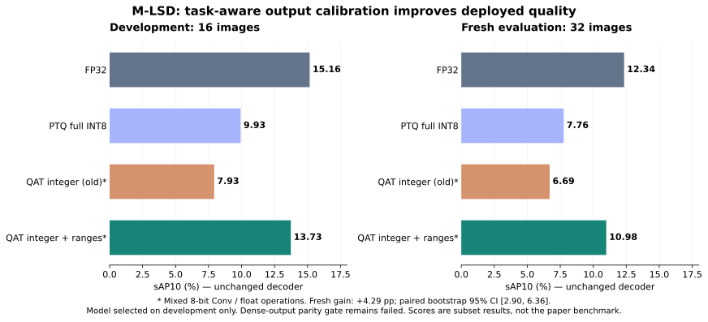

# M-LSD: tìm nguyên nhân và kiểm tra cách cải thiện

**Kết quả chính:** hiệu chỉnh range output theo tác vụ giúp bản ONNX integer tăng sAP10 từ **6,69% lên 10,98% trên 32 ảnh mới**, tương đương giữ khoảng **89% mức FP32 12,34%**. Cả bản cũ và mới đều chạy 41 Conv integer 8-bit và giữ các bước khác ở float. Model được chọn vẫn dùng đúng weight QAT bước 32; phần cải thiện chính là calibration, không phải train thêm.

## So sánh chất lượng

Hai cột là hai tập ảnh khác nhau; chỉ so model trong cùng cột. Decoder và cách tính sAP10 giữ nguyên từ ngày 13, không đổi threshold để tăng điểm.

| Cấu hình | 16 ảnh development | 32 ảnh mới |
|---|---:|---:|
| FP32 gốc | 15,16% | 12,34% |
| PTQ TFLite tách head, full INT8 | 9,93% | 7,76% |
| QAT bước 32, fake quant cũ | 8,20% | 6,64% |
| QAT bước 32, ONNX integer cũ, mixed | 7,93% | 6,69% |
| QAT bước 32 + range mới, fake quant | 13,70% | 11,29% |
| QAT bước 32 + range mới, ONNX integer, mixed | **13,73%** | **10,98%** |

Mức tăng của hai bản ONNX cùng phạm vi precision là **4,29 điểm phần trăm**; paired bootstrap theo ảnh, 1.000 lần, seed 20261015, cho khoảng tin cậy percentile 95% **[2,90; 6,36] điểm**. Đây là ước lượng trên subset này, không phải bảo đảm cho dataset khác. So với PTQ full INT8, bản mới tăng 3,22 điểm, nhưng hai bản có phạm vi precision khác nhau nên không dùng so sánh đó để kết luận QAT full INT8 thắng PTQ.

## Điều gì gây mất chất lượng?

M-LSD tạo đoạn thẳng từ center và bốn displacement đến hai đầu mút. Vì vậy center phải chọn đúng điểm, còn displacement phải giữ đủ độ chính xác tọa độ. Đây là cấu trúc TP được mô tả trong [paper M-LSD, phần 3.2–3.3](https://arxiv.org/html/2106.00186).

Ablation dưới đây dùng cùng weight bước 32, không train lại. Các lượt bỏ fake quant chỉ để chẩn đoán, không phải bản deploy INT8.

| Thay đổi so với fake quant cũ | sAP10 development |
|---|---:|
| Không thay đổi | 8,20% |
| Bỏ fake quant ở displacement output | 11,00% |
| Bỏ fake quant ở center output | 10,20% |
| Bỏ fake quant ở cả hai output | 14,33% |
| Chỉ fake quant weight, bỏ fake quant activation | 14,67% |
| Chỉ fake quant activation, bỏ fake quant weight | 8,34% |

Trong cấu hình đang thử, activation và hai output nhạy hơn weight. Đây là kết luận có đối chứng trên checkpoint này, không khẳng định mọi model đều như vậy.

Trên 32 ảnh train, displacement trước fake quant có outlier khoảng **−804 đến +796**. Với vùng teacher có confidence >0,1, cực trị mỗi kênh chỉ khoảng **−115 đến +117**. Range cũ làm displacement có bước lượng tử **7,03 đơn vị map**. Hiệu chỉnh theo vùng có khả năng tạo line và tách scale theo kênh giảm bước còn khoảng **0,49–0,87**. Các giá trị nền bị clip nhiều hơn để dành độ phân giải cho tọa độ hữu ích; không tối ưu sai số của mọi pixel như nhau.

Để thấy độ lớn: trên grid 128 dùng chấm sAP, riêng sai số làm tròn displacement với bước 7,03 có cận tổng bình phương sai số hai đầu mút khoảng **12,34**, đã vượt ngưỡng match 10. Với bốn bước mới, cận đó khoảng **0,125**. Đây chỉ là cận khi không clip và chưa tính sai số các layer khác, không phải dự đoán trực tiếp AP.

## Cách hiệu chỉnh và đối chứng loss

Range displacement lấy từ output trước lượng tử của model QAT trên **32 ảnh Wireframe train**, tại pixel teacher FP32 có confidence >0,1, cộng margin 2% mỗi phía và scale riêng cho bốn kênh. Range center có cận dưới `logit(0.005)`, thấp hơn score gate cố định 0,01 của decoder; cận trên lấy max train cộng margin 2%. Vì cận dưới vẫn dưới score gate, nền bị clip ở đó không tự thành một line hợp lệ.

Trên development, chỉ đổi range displacement đạt khoảng 11,04%; kết hợp đổi range center đạt 13,70%. Đã thử cả displacement per-tensor và per-channel, chọn per-channel theo development trước khi chạy 32 ảnh mới. Việc lựa chọn/clipping range cần kiểm chứng theo model, như hướng dẫn [Practical Quantization in PyTorch](https://pytorch.org/blog/quantization-in-practice/); quy tắc foreground/center cụ thể ở đây là thử nghiệm riêng của repo, không phải recipe được paper M-LSD chứng minh.

Giả thuyết thứ hai là loss hình học quá nhỏ: code cũ chia displacement 128 trước Smooth L1 beta=1. Thử nghiệm mới dùng Smooth L1 trên displacement gốc rồi chia loss 128, tương đương đổi beta trên giá trị đã normalize. Đo gradient final Conv trên bốn ảnh train: ở hai ảnh, norm gradient center lớn hơn displacement cũ khoảng 167 và 245 lần; ở hai ảnh còn lại chỉ khoảng 3–5 lần. Vì thế không kết luận mất cân bằng xảy ra như nhau trên mọi ảnh.

Bốn nhánh dưới đây cùng khởi đầu từ model và AdamW state bước 32, cùng lr=1e-5, thứ tự mẫu, 32 ảnh train, teacher và decoder; mỗi nhánh mới thêm 96 bước. Nhánh không thay đổi lấy từ lượt continuation đã chạy trước.

| Range / loss | Bước 32 | Bước 64 | Bước 128 |
|---|---:|---:|---:|
| Cũ / cũ | 8,20% | 8,03% | 7,85% |
| Mới / cũ | 13,70% | 13,31% | 13,32% |
| Cũ / đổi Smooth L1 | 8,20% | 7,60% | 7,94% |
| Mới / đổi Smooth L1 | 13,70% | 13,40% | 13,13% |

Đổi loss riêng không cải thiện rõ. Trong giới hạn dữ liệu/budget này, calibration output giải quyết được nhiều hơn việc tăng số bước hoặc đổi loss. Không gọi việc thay Smooth L1 là tái lập matching/geometric loss của paper; các lượt này vẫn học từ pseudo-label teacher.

## Đánh giá mới và export

Đã khóa 32 ảnh YorkUrban khác 16 ảnh development theo ID và SHA256, cùng revision dataset. Chúng không dùng cho calibration, gradient hay chọn cấu hình. Quyết định chọn model và hash checkpoint được lưu trước khi chạy holdout. Đây là ảnh mới đối với quá trình nghiên cứu này; chưa audit được dữ liệu từng dùng để tạo pretrained weights, nên không khẳng định chúng chưa từng xuất hiện trong nguồn pretrain.

ONNX profiler xác nhận 41 ConvInteger chạy trên CPU. Weight/activation dùng mã UINT8 offset từ signed 8-bit, tích lũy INT32; bias, residual, resize, scale và một số phép khác còn float. Fake quant và integer cho sAP10 gần nhau trên development, nhưng dense-output relative L2 vẫn **5,91%**, vượt gate 2% cũ; trên holdout khoảng **5,53%**. Gate vẫn được ghi là thất bại. Chất lượng detect line đã cải thiện có đối chứng, còn tương đương tensor toàn mạng chưa được giải quyết.

Tốc độ được đo lại trong [matched_benchmark.json](experiments/qat/results/research/matched_benchmark.json): chỉ một ORT session/thread pool tồn tại mỗi lượt, 4 intra/1 inter threads, 5 vòng đổi thứ tự model, warm-up riêng, 80 mẫu thời gian/model. Các lượt đo nhiều session cùng tồn tại hoặc tắt spinning được giữ riêng để tránh trộn protocol. Model integer hiện chưa phải deployment đã tối ưu tốc độ; không suy tốc độ Android từ số CPU này.

DistilBERT vẫn là mốc QAT 128 bước, accuracy 90% trên 100 câu, chưa export integer. Phần còn lại của tuần là kiểm tra range với nhiều ảnh train hơn, thử supervised/matching loss từ nhãn Wireframe, chọn backend integer phù hợp và đánh giá trên nguồn ảnh khác. Không dùng lại 32 ảnh mới để tiếp tục chọn cấu hình rồi gọi chúng là holdout độc lập.

[Diagnostics](experiments/qat/results/research/diagnostics.json) · [Đối chứng center/range](experiments/qat/results/research/center_calibration.json) · [Quyết định chọn model](experiments/qat/results/research/selection.json) · [32 ảnh mới và CI](experiments/qat/results/research/holdout_evaluation.json) · [Export](experiments/qat/results/research/deployment.json) · [Kiểm chứng](experiments/qat/results/research/verification.json)

## Bổ sung: tách sai lệch lượng tử và sai lệch convolution

Mục tiêu của lượt bổ sung là kiểm tra export trên development, giữ nguyên model đã chọn. Không train, hiệu chỉnh range lại hay dùng 32 ảnh đã đánh giá để chọn cấu hình mới. Kết quả và artifact nằm riêng ở `results/export-parity/` và `artifacts/export-parity/`.

[QuantizeLinear của ONNX](https://onnx.ai/onnx/operators/onnx__QuantizeLinear.html) định nghĩa lượng tử hóa qua scale và làm tròn về số chẵn ở điểm giữa. [Kernel fake quant CPU của PyTorch](https://github.com/pytorch/pytorch/blob/main/aten/src/ATen/native/quantized/cpu/kernels/QuantizedOpKernels.cpp) tính nghịch đảo scale trong FP32 rồi nhân trước khi làm tròn. Hai biểu thức tương đương trên số thực, nhưng có thể khác một mức lượng tử với FP32 sát ngưỡng. Offset UINT8 không tự giải quyết khác biệt này.

Trên cùng đầu vào thật của 43 bộ lượng tử ở ảnh development đầu tiên, biểu thức chia scale khác fake quant ở **37/37.274.036 giá trị**; nhân nghịch đảo FP32 trước khi làm tròn khớp tất cả các giá trị đó. Đây là kiểm tra cùng đầu vào, không phải so hai activation đã bị lệch từ lớp trước. Verifier còn chạy ONNX Runtime với các điểm giữa mức lượng tử, giá trị FP32 liền kề, clipping và broadcast per-channel; đối chứng độc lập là operator fake quant PyTorch.

`export_parity.py` tạo ONNX riêng bằng cách thay 43 `QuantizeLinear` bằng `Mul → Round → Add → Clip → Cast` với scale/zero-point đã freeze. Các constant gốc và tất cả node khác giữ nguyên byte. Không đổi ConvInteger, parameter, checkpoint hoặc decoder. ORT có tối ưu/fold một phần biểu thức; profiler vẫn xác nhận 41 ConvInteger CPU và không có Conv float. Cách biểu diễn này thêm phép toán float, vẫn là mixed integer/float và chưa được đo tốc độ.

| Trên 16 ảnh development | Relative L2 so với fake quant gốc | sAP10 |
|---|---:|---:|
| ONNX integer sau calibration, trước sửa | 5,9066% | 13,7334% |
| ONNX với biểu diễn làm tròn mới | 5,6565% | 13,7053% |
| PyTorch fake quant, tắt MKLDNN, chỉ để chẩn đoán | 5,4702% | 13,5656% |

Sai số bản ONNX giảm 0,2501 điểm phần trăm, khoảng 4,23% tương đối; sAP10 gần giữ nguyên nhưng giảm nhẹ, không phải tăng thêm chất lượng detect line. Gate giữ nguyên: relative L2 ≤2% và chênh sAP10 tuyệt đối ≤0,5 điểm. **Bản mới vẫn thất bại ở gate relative L2.**

Để kiểm tra convolution riêng, verifier export mỗi lớp rồi chạy bằng chính đầu vào PyTorch của lớp đó trên ảnh đầu tiên. Relative L2 lớn nhất của **41 convolution là 9,05×10⁻⁷** sau sửa lượng tử. Sai số cục bộ nhỏ chưa bảo đảm output toàn mạng gần nhau vì các lớp sau tiếp tục làm tròn activation. Thí nghiệm đổi backend convolution trong chính PyTorch tạo sai số toàn mạng 5,4702% dù không đổi weight, range hoặc operator fake quant. Điều này hỗ trợ giả thuyết model nhạy với sai số số học và việc vượt ngưỡng làm tròn qua nhiều lớp; chưa định lượng được đóng góp riêng của từng lớp trên mọi ảnh.

Verifier tái tạo chính xác output ONNX trên 16 ảnh, tính lại AP và parity, kiểm graph/profiler và xác nhận hash dữ liệu kết quả đã khóa giữ nguyên. `verification.json: status=passed` chỉ xác nhận bằng chứng; `export_parity_gate_passed=false` vẫn được lưu riêng. Bản mới chưa chạy holdout hoặc benchmark, nên không gán điểm 10,98% hay thời gian 231,62 ms của bản trước cho bản này.

Bước tiếp theo là khoanh vùng lớp làm sai lệch khuếch đại trên development, kiểm tra tính ổn định số học khi QAT, rồi khóa bản sửa trước một lượt đánh giá độc lập mới. Không nới gate để gọi export đạt và không thay kết quả holdout đã công bố.

[Phép sửa và metric](experiments/qat/results/export-parity/rounding.json) · [Audit 41 lớp, đối chứng backend và kiểm chứng](experiments/qat/results/export-parity/verification.json)
