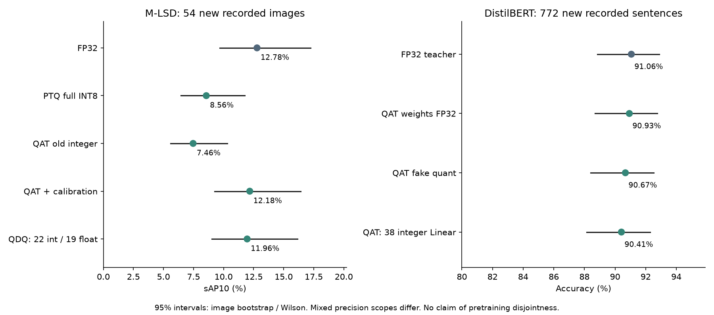

# Báo cáo tuần 12–16/10/2026

Người thực hiện: Bùi Gia Huy.

Trong tuần em tiếp tục hậu xử lý M-LSD, thử PTQ, chạy QAT cho M-LSD và DistilBERT đến 128 bước/model, rồi export và đánh giá trên CPU, bổ sung đối chiếu CUDA trên GPU máy hiện tại. M-LSD dùng 32 ảnh Wireframe train với pseudo-label teacher; DistilBERT dùng 256 câu SST-2, CE kết hợp distillation. Đây là thực nghiệm nhỏ, chưa phải training đầy đủ.

## Kết quả cuối tuần

M-LSD được đánh giá trên 54 ảnh mới đối với các manifest thực nghiệm đã ghi nhận, dùng cùng decoder và evaluator subset. DistilBERT dùng 772 câu validation mới, cùng tokenizer và độ dài 64 token. Các khoảng tin cậy và dữ liệu thô được lưu cùng kết quả.

| M-LSD | sAP10 trên 54 ảnh | Median / p95 ms | Precision thực thi |
|---|---:|---:|---|
| FP32 | 12.78% | 27.56 / 29.30 | Float |
| PTQ tách head | 8.56% | Chưa đo cùng lượt này | Full INT8 TFLite |
| QAT integer cũ | 7.46% | Chưa đo cùng lượt này | 41 ConvInteger, boundary float |
| QAT + calibration | 12.18% | 86.32 / 90.30 | 41 ConvInteger, boundary float |
| QAT + QDQ | 11.96% | 48.59 / 51.15 | 22 Conv integer, 19 Conv float |

| DistilBERT | Đúng / 772 câu | Accuracy | Median / p95 ms |
|---|---:|---:|---:|
| FP32 teacher | 703 | 91.06% | 22.28 / 23.16 |
| Weight QAT, tắt fake quant | 702 | 90.93% | 22.35 / 23.67 |
| QAT fake quant | 700 | 90.67% | Chưa benchmark PyTorch |
| QAT static integer | 698 | 90.41% | 18.44 / 19.83 |

Timing là inference CPU, batch 1, 4 thread, một ORT session mỗi lượt, 80 mẫu/model; không gồm load, preprocess, decode hoặc Android. Model M-LSD FP32/QDQ có kích thước 2.39/0.74 MiB; DistilBERT FP32/integer là 255.48/132.50 MiB.

## Nhận xét

Cải thiện rõ nhất của M-LSD đến từ calibration output. Cùng phạm vi 41 ConvInteger, sAP10 tăng 4.71 điểm, CI 95% [3.55; 6.26]. Train thêm hoặc đổi loss chưa chứng minh hiệu quả rõ, nên em không quy điểm tăng này cho việc train QAT lâu hơn. QDQ giảm latency so với bản 41 ConvInteger nhưng vẫn chậm hơn FP32 và có 19 Conv trở lại float.

DistilBERT đã xác nhận 38 Linear chạy integer bằng profiler. Bản export giữ static scale QAT; embedding, attention MatMul/Softmax và normalization vẫn float. So với fake quant trên tập mới, chênh accuracy là -0.26 điểm, CI paired bootstrap 95% [-0.78; 0.26]. Chưa có cơ sở kết luận QAT tốt hơn PTQ từ các đối chứng hiện có.

Trong bốn ảnh minh họa cố định, P1080119.png là ca khó ở cả baseline: sAP10 trên riêng ảnh này chỉ 1.38% với FP32 và 1.48% với QDQ. Cần xem thêm dữ liệu và decoder, không quy toàn bộ lỗi cho lượng tử hóa.

## Kiểm thử thêm trên GPU máy hiện tại

RTX 3050 Laptop 4 GB, driver 572.61. Lượt này dùng cùng ONNX Runtime GPU 1.20.2 cho cả CPU và CUDA, tách khỏi bảng CPU ORT 1.30 ở trên. Giữ nguyên 54 ảnh và 772 câu, không chọn lại model. Chất lượng là sAP10 với M-LSD, accuracy với DistilBERT.

| Model | Median CPU / CUDA (ms) | Chất lượng CPU / CUDA |
|---|---:|---:|
| M-LSD FP32 | 27.11 / 7.51 | 12.78% / 12.78% |
| M-LSD FP16 | 61.03 / 5.83 | 12.70% / 12.65% |
| M-LSD QAT 41 ConvInteger | 234.65 / 77.05 | 12.18% / 12.17% |
| M-LSD QAT QDQ | 75.45 / 13.46 | 12.08% / 12.09% |
| DistilBERT FP32 | 62.50 / 6.59 | 91.06% / 91.06% |
| DistilBERT FP16 | 134.19 / 6.65 | 91.06% / 91.06% |
| DistilBERT QAT static | 11.32 / 43.29 | 90.16% / 90.28% |

M-LSD FP16 GPU đạt 5.83 ms so với CPU FP32 27.11 ms; DistilBERT FP32 GPU đạt 6.59 ms so với CPU 62.50 ms; FP16 6.65 ms chưa cải thiện tốc độ. FP16 là giảm precision float, không phải QAT INT8.

Profiler xác nhận 41 ConvInteger của M-LSD và 38 MatMulInteger của DistilBERT vẫn ở CPU khi bật CUDA; phần float chạy GPU. M-LSD QDQ trên ORT 1.20.2 chạy 41 Conv float cả CPU và CUDA, khác bản CPU ORT 1.30 đã fuse 22 Conv integer. DistilBERT QAT bị chia CPU/GPU kèm truyền dữ liệu, median CUDA 43.29 ms còn chậm hơn CPU 11.32 ms. Vì vậy tốc độ GPU ở đây chưa chứng minh tăng tốc integer.

Mỗi cấu hình chạy trong process riêng, 16 warm-up và 80 lượt đo, batch 1, 4 thread; session.run đồng bộ gồm truyền CPU–GPU, không gồm preprocess/decode. TF32 tắt. cuDNN báo không có execution plan ở một số lần chọn kernel FP16 M-LSD nhưng inference và profiler hoàn tất với output hữu hạn. Đây là đối chiếu runtime trên dữ liệu đã đánh giá, không phải test set mới. [Bằng chứng GPU và kiểm chứng](experiments/finalize/results/gpu/verification.json).

## Phần chưa đạt

Gate tương đương tensor trên development vẫn thất bại: relative L2 M-LSD QDQ 8.88%, DistilBERT 5.55%. Kiểm chứng bằng chứng đạt không đồng nghĩa model đạt mọi gate. Chưa triển khai full INT8, chưa train M-LSD bằng supervised matching loss và chưa đo Android. Đánh giá là các subset có kiểm soát, không phải benchmark paper hay bằng chứng dữ liệu chưa xuất hiện trong pretrained weights.

Hướng tiếp theo là xử lý độ nhạy số học khi export và thử supervised QAT có đối chứng, sau đó kiểm tra trên thiết bị đích.

[Ảnh so sánh cố định](figures/line-comparison.png) · [M-LSD và CI](experiments/finalize/results/mlsd_final.json) · [DistilBERT và CI](experiments/finalize/results/text_final.json) · [Timing M-LSD](experiments/finalize/results/mlsd_benchmark.json) · [Timing text](experiments/finalize/results/text_benchmark.json) · [Kiểm chứng](experiments/finalize/results/verification.json) · [Tái lập](RUNNING.md)
